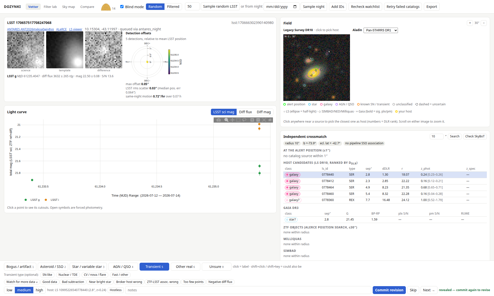
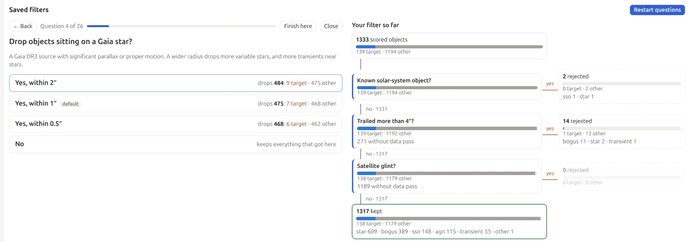
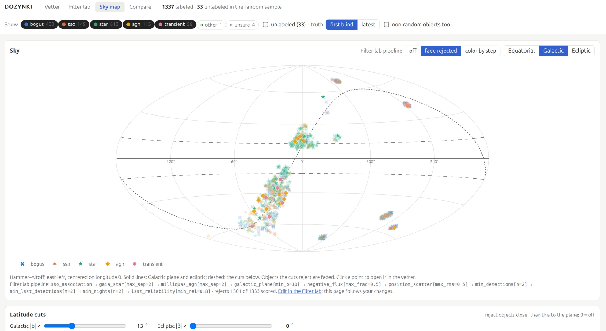
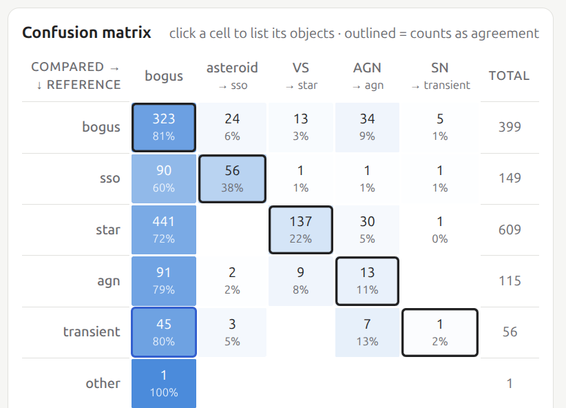

# DOZYNKI

DOZYNKI helps us pull needles from the haystack of LSST and ZTF alerts by bringing transient brokers
(ANTARES, ALeRCE and Babamul) together in one place. Join the community in filtering out bogus alerts,
identifying real objects and their hosts, and creating new human labels.



- **[Vetter](#vetter-identify-transients-and-create-labels)** – label each object blind from the evidence
  (light curve, cutouts, field image, an independent crossmatch and host ranking), then see what the brokers
  think. Run it over a random sample or over a whole night, live.
- **[Filter lab](#filter-lab-filter-out-the-noise)** – build rejection filters by answering plain-language
  questions, and see what each one would throw away of the objects people have labeled.
- **[Sky map](#sky-map)** – where the labeled classes and a filter's rejections fall on the sky.
- **[Compare](#compare-labels-against-brokers-and-each-other)** – confusion matrices between labelers and
  ALeRCE's classifiers.

It runs on a laptop for one person, or as a shared server where several people label the same objects
independently.

The name DOZYNKI is inspired by the Polish harvest festival, reflecting the goal of harvesting scientific discoveries from the unprecedented abundance of modern surveys. It is also a nod to the never-ending “needle in the haystack” problem in astronomy: building a unified, flexible framework capable of efficiently searching immense datasets to identify rare and scientifically valuable transients.

Created and currently managed by UCSC PhD student Jenna Karcheski. Please contact me at jkarches@ucsc.edu with any feedback or if you want to join the development team! 

## Setup

```bash
python3 -m venv .venv
.venv/bin/pip install -r requirements.txt
cp .env.example .env    # add Babamul token (optional) and your labeler name
.venv/bin/python -m dozynki   # http://127.0.0.1:8765 (landing page; vetter at /vet)
```

## Vetter: identify transients and create labels

1. **Sample** – "Sample random LSST" draws a uniform random set of ANTARES loci
   that have an LSST diaObject (Elasticsearch `random_score`). The seed and
   query are saved with every queued object, so the selection function of the
   training set is known. The unit is the *object*, not the alert.
2. **Blind pass** – you see only evidence: the combined ZTF+LSST light curve
   (difference flux on a common nJy scale, plus Babamul forced photometry when
   configured), ANTARES cutouts, a Legacy Survey DR10 field image, and an
   *independent* crossmatch (LS DR10 with photo-z and DLR host ranking, Gaia DR3,
   PS1, Milliquas, SIMBAD, NED, optional SkyBoT). Pipeline SSO associations
   (Rubin `ssObjectId`, ZTF `ssnamenr`) are shown because they are positional
   facts, not classifier output.
3. **Reveal** – committing a blind label reveals broker opinions: ALeRCE
   classifier probabilities (each classifier version separately), LSST
   reliability / ZTF drb, ANTARES tags and catalog matches, Babamul flags and its
   ZTF association (flagged when it disagrees with ANTARES).
4. **Revise (optional)** – committing again stores a separate `revealed` label.
   Both are kept, so you can measure how much brokers shift your labels.

**Filters.** The bar under the header limits work to objects with at least N
detections (LSST + ZTF, upper limits not counted) and/or whose first alert, latest
alert, or alerting period falls in a date range. The same filters apply to "Sample
random LSST" (as an ANTARES query, recorded in each object's selection parameters) and
to which already-queued object comes up next. Note that ANTARES's "latest alert" includes
ZTF alerts, and its LSST objects currently have first alerts only through mid-July 2026.

**Sampling a night.** "Sample night" queues the next N random objects (the count box) whose first ANTARES
alert came on one Rubin night (dayObs: noon to noon UTC), with at least the filter bar's detections; the bar's
date range is ignored. The first sample of a night at a detection minimum fixes a random order (seeded on
`locus_id`, which new alerts don't change); later samples continue it, so they never repeat and, given time,
cover the whole night. ANTARES counts and pages only 10,000 matches, so a busier night can't be finished
at that minimum; raise it. Batches are recorded in the `night_pulls` table, and the landing page's Nights
card shows each night's progress: sampled and vetted of the night's size, and what is left. ANTARES's first alert includes ZTF, so objects
with earlier ZTF alerts are not part of a later night. Night samples are left out of the filter lab and
compare pages' default population, which is the uniform random sample.

**Random and Filtered modes.** The vetter's mode switch picks what you see. *Random* is everything sampled,
as drawn. *Filtered* runs a whole night through a saved filter from the filter lab ("Filter whole night"),
like ANTARES's per-night filter counts, so on a live night you vet only what passes and never sample more.
A night is every LSST object whose first or latest ANTARES alert came during it (the locus listing has no
other alert times, so for a past night this misses objects that alerted on it and again later). The run
(`nightrun.py`, table `night_runs`) has two stages:

1. The rules the locus listing answers run over the whole night at once: ANTARES applies detections,
   LSST solar-system association, its catalog matches (bright stars, Gaia variables, Milliquas at
   `max_sep` ≥ 1″) and the SCIMMA tag in its query, and Galactic latitude,
   ecliptic latitude and span run here on each listing (`rejection.LISTING_ES` / `LISTING_LOCAL`). This
   takes about 40 s for a 50,000-object night and gives "N of M pass".
2. Everything that passes is queued as `screening` in a random order, and a background thread (`screen.py`)
   fetches what the rules read, all of it stored by brokers: ANTARES's object, alerts and catalog matches,
   and ALeRCE only for a rule that reads it. Our own crossmatch (VizieR, SIMBAD, Legacy Survey, NED) waits
   until you open the object. It applies the whole filter and moves the object to `pending` or `filtered`. It also drops objects with no detection on the night. The rejecting step goes in
   `queue.screen_result` and every decision in `rejections`; an object that can't be fetched is kept
   (`screen_result` "error"). This runs at about 9 objects a second (8 workers), so a 30,000-object night is
   checked in about an hour, ahead of you as you vet.

The filter as it was is stored with the run and each object (`source_params.screen`). The two modes have
separate queues, so neither takes the other's objects; a random-mode sample that draws an object a filter
threw away takes it back into random mode, so Random stays random. The Nights card lists filtered nights
with their pass counts.

**Multiple classes.** Click (or press the digit) for the primary class; Shift+click
(or Shift+digit) adds "could also be" classes, e.g. primary *bogus* that could be a
*star*, or *AGN* that could be a nuclear *transient*. `is_real`/`is_transient` follow the
primary class; the export adds `alt_labels`, `possibly_real` and `possibly_transient`.

Keys: `1`–`6`, `0` class · Shift+digit alternative class · `w` watch · `Enter` commit · `n` next · `s` skip · `h` hostless · `f` cycle light-curve mode · `+`/`-` zoom.
Click anywhere near a source in the field image (the nearest one is picked) or a row of the host table to record the host.

**Detection offsets.** A polar plot (north up, east left) of each detection's position
relative to the mean LSST position, colored by time, with the rms scatter and a same-night
motion estimate. A stationary source clusters at the center; a mover makes a time-ordered
line. Objects cached before positions were stored get them backfilled into a separate cache.

**Source classes.** Catalog matches are colored by what the catalogs report (not a classifier):
star, galaxy, AGN/QSO, known SN/transient, unclassified. LS DR10 `type` gives star (PSF) or
galaxy (EXP/DEV/SER); a confident Gaia (significant parallax/proper motion), Milliquas, SIMBAD or
NED class within 1″ confirms or overrides it. Dashed outlines and a "?" mark uncertain classes
(PSF without a Gaia star, REX, Gaia without significant motion, SIMBAD candidates, disagreeing
catalogs); hover a marker or chip for the reasoning. The crossmatch panel lists everything within
1″ of the alert first. Colors and SIMBAD/NED type mappings live in `static/app.js`.

**Watchlist.** The "Watch for more data" flag parks an object (queue status `watch`).
"Recheck watchlist" re-polls ANTARES; objects with new alerts return to the queue, and
the next label is stored with phase `followup`. Un-toggle the flag to finish with it.

Label taxonomy, flags and hotkeys live in `dozynki/labels.py`.

## Filter lab: filter out the noise



Rejection filters are cuts that *throw objects away*, scored against human labels. Rules live in
`dozynki/rejection.py`. Each one reads only cached
payloads and returns reject, keep, or "no data" (kept). A pipeline is an ordered JSON list;
`cuts.example.json` is the default pipeline with every parameter spelled out, so copy it
(`cp cuts.example.json cuts.json`) and edit:

```json
[{"rule": "gaia_star", "max_sep": 1.5}, {"rule": "min_nights", "n": 2}, {"rule": "lsst_reliability", "min_rel": 0.3}]
```

Rules draw on the light curve, broker scores, and data brokers already store, not on the slow
independent crossmatch (Galactic and ecliptic latitude come from the position):
- **Rubin pipeline measurements** of each LSST detection: difference-image extendedness, dipole flag,
  glint-trail flag, PSF-fit χ²/N, size relative to the PSF (too sharp or too large), failed
  measurement flags, SNR and trail length. New fetches keep them (`antares.get_locus` "lsst_details");
  objects cached earlier get them from "Fetch them" in the filter lab (`details.py`, a separate
  `lsst_details` cache kind, so labeled evidence is untouched). Until then those rules see no data.
- **ZTF's PS1 star/galaxy score** of the nearest Pan-STARRS1 source (`sgscore1`, `distpsnr1`).
- **ANTARES's catalog matches** (`antares.catalog_matches`, cache kind `antares_catalogs`, within
  about 1 arcsec): Gaia DR3 with parallax and proper motion for `gaia_star` (significant at 5σ, the same
  cut the crossmatch makes) and Milliquas for `milliquas_agn`, so a `max_sep` above about 1″ reaches no
  further than ANTARES's match. Objects cached earlier get them from "Fetch them" in the filter lab.
- **ANTARES locus metadata**: its bright guide star and Gaia DR3 variability catalog matches (yes/no)
  and the SCIMMA quality-transient filter tag (broker output).

```bash
.venv/bin/python -m dozynki.evaluate --list-rules
.venv/bin/python -m dozynki.evaluate                       # default pipeline
.venv/bin/python -m dozynki.evaluate --pipeline cuts.json --target real
.venv/bin/python -m dozynki.evaluate --target transient:nuclear,agn --include-alt
```

**Filter lab.** `http://127.0.0.1:8765/rejection` (or the "Filter lab" tab)
does the same thing interactively for one pipeline, scored against no filter.
- Pick the target from chips: any class or transient subclass, optionally counting
  "could also be" classes.
- Toggle rules and edit thresholds; the metrics, the decision tree, the kept-by-class chart and
  the per-step table update as you type. Object IDs in the tree's lists open in the vetter
  (`/vet?object=<id>`).
- Sweep any threshold to plot completeness, purity and false-positive rate against
  it, then click a point to set it.

- **Build a filter with questions** walks through the rules one plain-language question at a time
  ("Drop objects sitting on a Gaia star?"), starting with what you want to keep. Each choice shows how many
  target and other objects it would throw away after your earlier answers, and the decision tree beside it
  grows as you answer. Questions, choices and their order live in `QUESTIONS` in `static/rejection.js`;
  a rule without an entry gets a generic yes/no question.
- **Decision tree** draws the pipeline as a cascade: each object falls to the first question it answers yes to.
  Bars show target vs other; click a box to list its objects.
- **Saved filters** are named pipelines stored in the `saved_pipelines` table, so every browser sees them.
  Save one from the pipeline card or at the end of the questionnaire, and load one back. The pipeline
  card shows which saved filter it came from and "(edited)" once it differs. The vetter's Filtered mode
  runs whole nights through one. On the command line:
  `.venv/bin/python -m dozynki.evaluate --saved "<name>"`.

Evaluating stores nothing in the database. Your other settings are remembered in the browser.

- **Truth** is each object's first blind label (`--truth final` for the latest label of any phase).
  Rules marked `broker` read reliability or ALeRCE output, which revealed labels may have seen.
- **Population** is the uniform random sample only (`--all-sources` to include everything),
  so the rates estimate the LSST stream within the recorded sampling filters. `unsure` is excluded.
- **Metrics** (Wilson 95% intervals): completeness (target kept / target), purity (target
  kept / kept), false-positive rate (non-target kept / non-target), bogus leak (bogus kept /
  bogus), against a no-filter baseline. The target is `transient` by default, or `real`.
- **Per step**: rejections by class with the step alone, rejections no other step makes,
  and the pipeline's metrics with that step left out.

Every step's decision is stored in the `rejections` table under the pipeline's version
hash, and each run writes `exports/rejection/<timestamp>/` (`report.txt`, `metrics.json`,
`decisions.csv` with the features behind each decision).

## Sky map



`http://127.0.0.1:8765/sky` (or the "Sky map" tab) plots every labeled object on a Hammer–Aitoff map in
equatorial, Galactic or ecliptic coordinates, colored by class (first blind or latest label). The filter lab's
current pipeline can be overlaid, fading what it rejects or coloring each object by the step that rejects it,
and the page follows your changes in the filter lab. Galactic and ecliptic latitude sliders try a latitude cut
and draw it on the map. Click a point to open it in the vetter. Like the filter lab, only the uniform random
sample is shown unless "non-random objects too" is on. Code lives in `dozynki/sky.py`.

## Compare: labels against brokers and each other



`http://127.0.0.1:8765/compare` (or the "Compare" tab) draws a confusion matrix between
any two label sources: each labeler's first blind or latest labels, and every ALeRCE
classifier found in the cache (top class). Nothing is stored. Code lives in `dozynki/compare.py`.
- Each source keeps its own class names (ALeRCE "SN", "VS", …), so the matrix need not be
  square. Agreement maps both sides onto the DOZYNKI classes with `ALERCE_CLASSES`; outlined
  cells count as agreement. "unsure" and unmapped classes (e.g. ALeRCE "Stochastic") are left out and counted.
- View all classes, or collapse to real vs not real, or transient vs not transient.
- Accuracy (Wilson 95%), Cohen's κ, and per-class recall / precision / F1. The reference is the rows.
- "ALeRCE top p ≥" drops low-confidence broker calls; "incl. could-also-be" adds an accuracy
  that also accepts a match with an alternative class.
- A table scores every source against the reference. Click a matrix cell to list its objects,
  most confident broker calls first, with links into the vetter.
- Blind vs latest for the same labeler shows how much revealing broker opinions shifted your labels.
- Like the filter lab, only the uniform random sample is used unless "non-random objects too" is on.

## Export

The "Export" button (or `python -m dozynki.export`) writes `exports/<timestamp>/`:

- `labels.parquet/csv` – every label row, blind and revealed
- `objects.parquet/csv` – one row per object: final label, blind label,
  `changed_after_reveal`, selection metadata, crossmatch summary, and
  `broker_*` columns kept separate from the label
- `lightcurves.parquet` – normalized photometry per object

## Layout

```
dozynki/
  app.py            FastAPI endpoints
  compare.py        confusion matrices between label sources (labelers, ALeRCE)
  assemble.py       fetch + cache per object, evidence / opinion split
  sources.py        queue sources (selection functions): random sample, night samples
  crossmatch.py     independent catalog crossmatch + DLR
  rejection.py      rejection rules; evaluate.py scores pipelines against labels
  nightrun.py       Filtered mode: run a night through a saved filter; screen.py checks it in the background
  sky.py            sky map data
  brokers/          antares.py, alerce.py, babamul_client.py
  db.py             SQLite (data/dozynki.sqlite): queue, cache, labels
  export.py         training-set export
  labels.py         taxonomy
  static/           UI (vanilla JS + Plotly)
```

## Planned

- Babamul Kafka topics and CSV object lists as queue sources
- ALeRCE LSST forced photometry in the light curve
- Anomaly scoring stage for objects labeled real transients

## AI disclosure

Much of DOZYNKI's code was written with Claude (Anthropic) through Claude Code, working from my design and
direction. I carefully and manually review and test everything that goes in. All bugs and breaks are my own.
